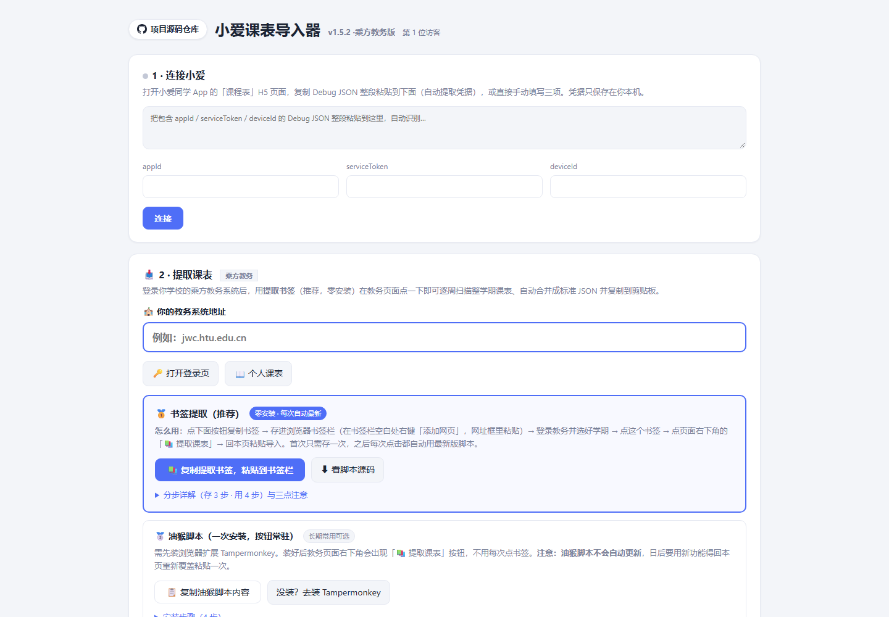

<div align="center">
  

  # 小爱课表导入器 · 乘方教务版

  **把整学期课表，一次性导入小爱课程表。**

  网页工具 · 书签 / 油猴 / Excel 三种提取方式 · 数据留在本机

  
  
  
  

  <a href="https://xiaoai-kebiao-zx.pages.dev">在线使用</a> · <a href="适配指南.md">适配指南</a> · <a href="https://github.com/tangjiafu430-bot/xiaoai-kebiao-importer">上游项目</a>
</div>



---

## 它解决什么问题

小爱课程表官方只提供手动添加课程：一门一门点，选星期、节次、周次、教室，十几门课要点很久，而且容易点错。

这个工具把流程改成：

1. 从乘方教务系统提取整学期课表；
2. 在网页里预览星期 × 节次的课程网格；
3. 一次性写入小爱课程表。

导入后，你可以对小爱说“我今天第一节什么课”“下一节课在哪”，也可以正常使用上课提醒。

---

## 功能

| 能力 | 说明 |
|---|---|
| **乘方教务一键提取** | 登录教务后点一下，自动逐周扫描全学期，合并单双周，复制成标准 JSON |
| **智能字段解析** | 自动识别河南师大 / 标准乘方的不同字段（星期、节次、周次、教室、教师） |
| **可视化预览** | 导入前用星期 × 节次的彩色网格核对，确认无误再写入 |
| **一键批量导入** | 写入指定小爱课表，支持导入前清空、同步节数与时间表 |
| **课表管理** | 查看、单条删除、全部清空、导出 JSON 备份 |
| **多种提取通道** | 浏览器书签、油猴脚本、上传教务导出的 Excel、智能粘贴，总有一种适合你 |
| **数据不出本机** | 教务 Cookie 不进入第三方；小爱凭据只存在你自己的浏览器里 |

---

## 三种提取方式

| 方式 | 适合谁 | 入口 | 依赖 |
|---|---|---|---|
| **浏览器书签（推荐）** | 不想装扩展，希望脚本永远是最新版 | 复制提取书签 → 存进书签栏 → 教务页点书签 → 点右下角按钮 | 后端在线 |
| **油猴脚本** | 长期用，希望按钮常驻 | 复制脚本内容 → 装进 Tampermonkey → 教务页右下角按钮 | 不依赖后端 |
| **上传 Excel** | 教务有“导出课表为表格”功能 | 选择 `.xls` / `.xlsx` → 自动预览 | 无需扩展、无需接口 |
| **智能粘贴（兜底）** | 上面都用不了，或只有零星几门课 | 粘贴接口 JSON / 页面文字 / 手打 | 无 |

书签和油猴的差别：

| | 书签 | 油猴 |
|---|---|---|
| 安装成本 | 零（存一个书签） | 需安装 Tampermonkey |
| 脚本版本 | 每次点击现拉，永远最新 | 装完即固定，不会自动更新 |
| 依赖后端 | 是，后端关闭时点击没反应 | 否，脚本在本地 |
| 页面注入范围 | 只注入顶层框架 | 注入所有同源 iframe |

Excel 通道有一个已知限制：教务导出的表格通常只有“第一大节 / 第二大节”这样的节次号，**没有每节课的上下课时刻**。解析后要在课表设置里选择夏令时 / 冬令时，或手动填时间表，否则导入小爱后时间会不准。

---

## 快速开始

### 在线使用

打开 **<https://xiaoai-kebiao-zx.pages.dev>** 即可，不需要装 Node，也不需要下载项目；手机浏览器也能用。

### 本地运行

要求 Node.js 18+。

```bash
git clone https://github.com/kidnappe/xiaoai-class.git
cd xiaoai-class
node scripts/dev_server.mjs 8787
```

打开 <http://localhost:8787>。Windows 也可以直接双击根目录的 `启动导入器.bat`，脚本会自动检测端口、启动服务并打开浏览器。

> 书签方式必须通过 `http://` 打开页面，不要直接双击 `index.html` 用 `file://` 打开。

### 获取小爱课程表凭据

凭据共三项：`appId`、`serviceToken`、`deviceId`。在手机上操作：

1. 打开小爱同学 App，进入“课程表”；
2. 进入课程表设置；
3. 滑到页面最底部，对着空白处连续点击五下；
4. 进入 Debug 页面，点“获取 userinfo”；
5. 把弹出的内容整段复制，回到导入器粘贴，页面会自动识别三项。

这是全程唯一需要在手机上完成的环节。不同 App 版本的界面细节略有差异，但入口都在课程表设置页底部。

### 完整导入流程

1. **连接小爱**：把 userinfo 整段粘贴到“连接小爱”，点“连接”。
2. **提取课表**：保存提取书签（或安装油猴脚本），登录教务，进入个人课表，在学期下拉框选中要提取的学期，点书签，再点页面右下角的“提取课表”。
3. **粘贴并预览**：回到导入器，从剪贴板粘贴 JSON，检查星期 × 节次网格。
4. **选择目标课表**：选已有课表，或新建一个（例如“2026 秋”）。
5. **按需勾选**：导入前清空旧课、同步课表设置（上午 / 下午 / 晚上节数与总周数）。
6. **导入**：点“导入到小爱”，确认后等待“导入成功”。

---

## 适用学校

本工具按**教务系统厂商**适配，不按学校：

| 教务系统 | 结论 |
|---|---|
| **乘方科技**（接口里能找到 `getCalendarWeekDatas`） | 本项目的目标系统，大概率开箱即用 |
| **强智**（jsxsd，如广州番禺、长沙理工、中南大学） | 请用上游原版：[tangjiafu430-bot/xiaoai-kebiao-importer](https://github.com/tangjiafu430-bot/xiaoai-kebiao-importer) |
| 正方、青果、URP、超星、树维等 | 不在本项目范围 |

已经完整实测通过的学校是**河南师范大学**（`jwc.htu.edu.cn`，10 节 / 天、19 周）。其他乘方部署使用同一套私有协议，字段大体相同，但个别命名和编码可能不同。

判断方法：登录教务 → `F12` → 网络 → 刷新课表页 → 找到 `getCalendarWeekDatas` 请求。找不到就不是乘方系统。

---

## 隐私与安全

- 教务登录 Cookie 全程只在你自己的浏览器里，提取脚本和表格解析都在本机完成。
- 小爱凭据（`appId` / `serviceToken` / `deviceId`）保存在**你本机浏览器的 localStorage**，用于下次自动回填；它只会被发往小米的课表服务器，本项目后端不保存副本。
- 后端只在内存里保留会话，不落盘。
- 请只在可信设备上使用。凭据不会因为关闭网页而消失；在机房、图书馆等公用电脑上使用后，请清除该站点的浏览器数据。目前页面内还没有“退出并清除凭据”按钮。

---

## 本地开发与部署

### 构建提取脚本

提取脚本的源头在 `tools/cf_extractor.js`。改完后必须重新注入构建：

```bash
node scripts/build_functions.mjs
```

它会做两件事：

1. 把最新脚本内联进 Cloudflare 后端；
2. 生成独立的油猴脚本 `tools/cf_kebiao_extractor.user.js`。

### 测试

```bash
node scripts/test_backend.mjs      # 后端路由
node scripts/test_frontend.mjs     # 前端解析逻辑
node scripts/test_extractor.mjs    # 提取脚本核心逻辑
```

### 部署到 Cloudflare Pages

线上环境使用 **Direct Upload + GitHub Actions**：推送到 `main` 分支时，`.github/workflows/deploy.yml` 会在 CI 里执行 `wrangler pages deploy`，把仓库内容（含 `functions/` 后端）上传到 Pages。

需要配置两个 Secret：

- `CLOUDFLARE_API_TOKEN`：权限只需 Account / Cloudflare Pages / Edit
- `CLOUDFLARE_ACCOUNT_ID`

手工部署与 CI 等价：

```bash
npx wrangler login
npx wrangler pages project create <项目名> --production-branch main
npx wrangler pages deploy . --project-name <项目名>
```

> `worker/` 目录保留了把同一套后端部署成 Worker 的能力，但实测 `*.workers.dev` 在中国大陆被 DNS 污染、无法访问。除非你已经给 Worker 绑定自己的域名，否则请直接使用 Cloudflare Pages 单站方案。

---

## 项目结构

```text
index.html                        导入器主页面
vendor/xlsx.full.min.js           唯一第三方库：解析教务导出的 .xls / .xlsx
启动导入器.bat                     一键本地启动
functions/api/[[path]].js         后端路由 + 小爱客户端
worker/                           把同一套后端部署成 Cloudflare Worker
tools/cf_extractor.js             提取脚本源（改这里）
tools/cf_kebiao_extractor.user.js 构建产物：独立油猴脚本
scripts/                          build / dev_server / 三套测试
.github/workflows/deploy.yml      push 即自动部署到 Cloudflare Pages
reference/                        调研资料（原项目、乘方 API 文档、样例）
适配指南.md                        新学校接入手册
```

---

## 常见问题

<details>
<summary><b>提取报错“学期 XXXX 下未查到课程”？</b></summary>

学期代码猜错了。在教务页面右键“提取课表”按钮，手动输入正确学期代码；或打开个人课表，按 F12 → 网络，找到 `getCalendarWeekDatas` 请求，看载荷里的 `xnxqdm` 值。
</details>

<details>
<summary><b>右下角出现多个“提取课表”按钮？</b></summary>

之前装过多个脚本副本。去 Tampermonkey 管理面板删掉多余条目，只留一个；或确认用的是最新版脚本。
</details>

<details>
<summary><b>课程全挤在某一天 / 星期不对？</b></summary>

多为旧版脚本。重新复制油猴脚本内容，覆盖旧脚本并保存，然后刷新教务页面。
</details>

<details>
<summary><b>连接小爱提示凭据不完整？</b></summary>

没点到“获取 userinfo”、复制内容不完整，或 App 版本字段名不同。回到手机，按“获取小爱课程表凭据”重新操作；仍不行就手动把 `appId` / `serviceToken` / `deviceId` 分别填进三个输入框。
</details>

<details>
<summary><b>导入后小爱里时间或节数不对？</b></summary>

勾选“同步课表设置”重新导入；或在预览下方的课表设置面板手动填上午 / 下午 / 晚上节数与总周数。
</details>

<details>
<summary><b>我学校不是河南师大，能用吗？</b></summary>

只要是乘方教务就可以试。提取到的星期 / 节次 / 时间有偏差时，按“适配新学校”里的信息提 Issue。
</details>

---

## 已知限制

- 只支持乘方科技教务系统；强智、正方、青果等不在范围内。
- 书签方式依赖后端在线；后端关闭时点击书签没有反应。
- Excel 通道没有上下课时刻，需要手动套用学校作息。
- 小爱接口是私有协议，可能随 App 版本变化。
- 凭据保存在 localStorage，目前没有页面内的“退出并清除凭据”按钮。
- 这是学生自用项目，不承诺处理时限，也不会代你登录教务排查问题。

---

## 参与贡献

### 适配新学校

先读 [`适配指南.md`](适配指南.md)。新学校接入需要回答六个问题：

1. 课程名字段；
2. 星期编码；
3. 节次形式；
4. 周次来源；
5. 上下课时间；
6. 学期代码。

提 Issue 时请带上：

```text
1. 教务域名（如 jwc.xxx.edu.cn）+ 能不能找到 getCalendarWeekDatas
2. 该请求的载荷原文（能看到 xnxqdm / zc / d1 / d2 等参数）
3. 该请求响应里的 1~2 条完整记录（请先删掉姓名、学号等个人信息）
4. 一门你确定上过的课：星期几、第几节、哪几周、几点上课
5. 学校作息：一天几节、一节课多少分钟、课间多少分钟
6. 报错原文
```

> 自己改代码时最容易漏的一条：字段解析在 `tools/cf_extractor.js` 和 `index.html` 里**各写了一份**，分别服务“脚本提取”和“粘贴原始 JSON”两条通道，必须同时改两处。只改一份会出现“脚本能提取、粘贴解析不出课程”的故障。

### 普通贡献

欢迎 Issue 和 PR。一个 PR 只做一件事；涉及解析逻辑的改动请同时跑三套测试。

---

## 许可证

[MIT License](LICENSE)。

> 仅供学习交流。教务系统接口为厂商私有协议，可能随版本变化；请遵守所在学校的使用规范，导入前建议先导出 JSON 备份。

---

## 致谢

- 原项目（强智教务版全栈）：[tangjiafu430-bot/xiaoai-kebiao-importer](https://github.com/tangjiafu430-bot/xiaoai-kebiao-importer)
- 乘方教务接口逆向文档：[xyj19/chengfang-edu-api-docs](https://github.com/xyj19/chengfang-edu-api-docs)
- 乘方教务 Python SDK 参考：[RS-Nocsi/wyu-jwxt](https://github.com/RS-Nocsi/wyu-jwxt)
